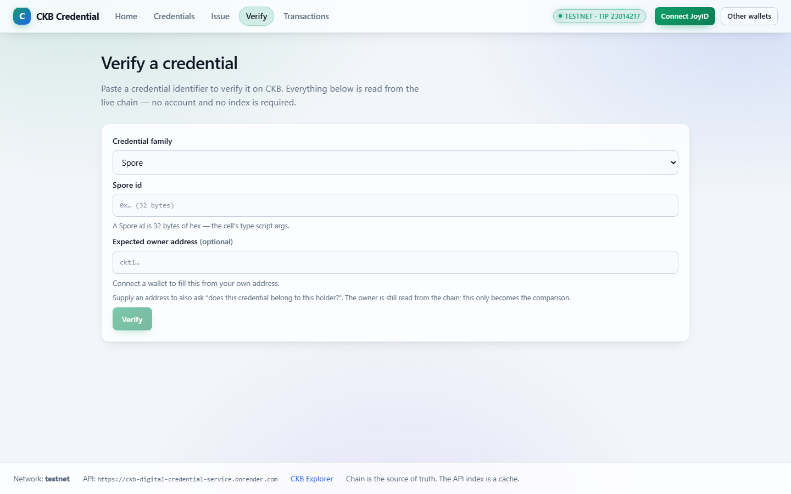
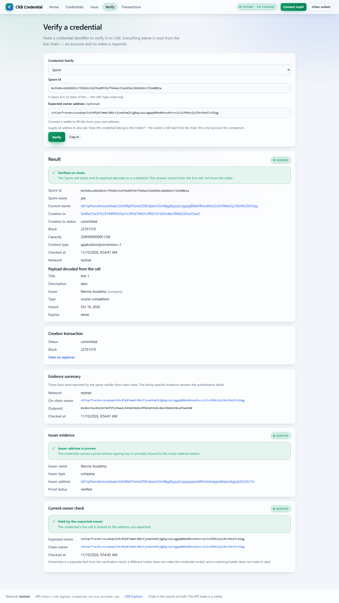
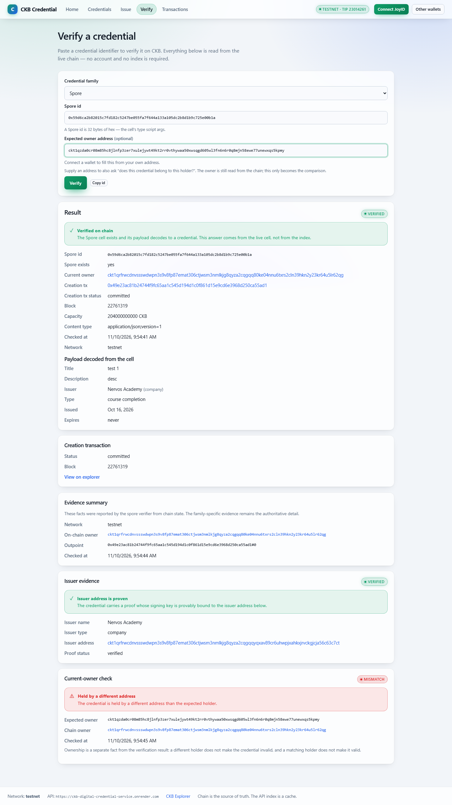
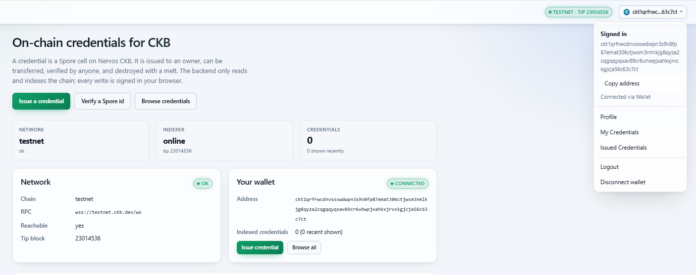
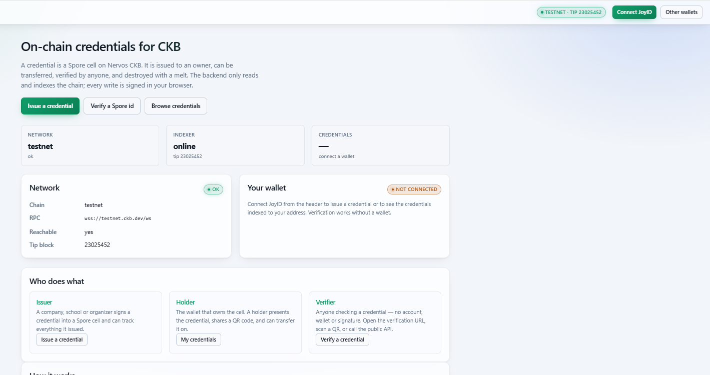
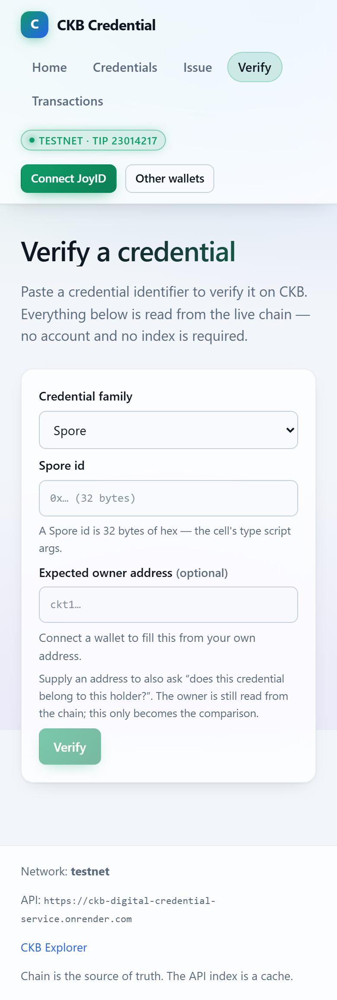
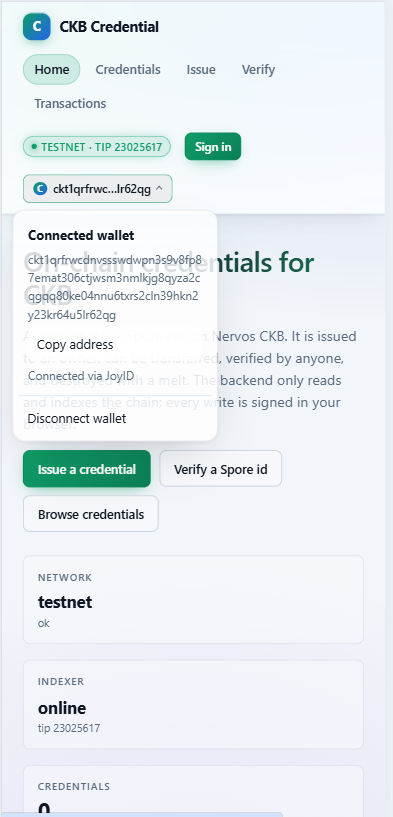
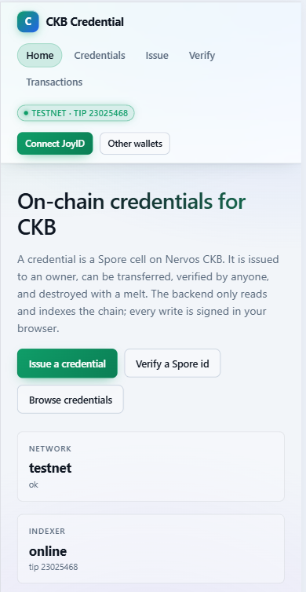
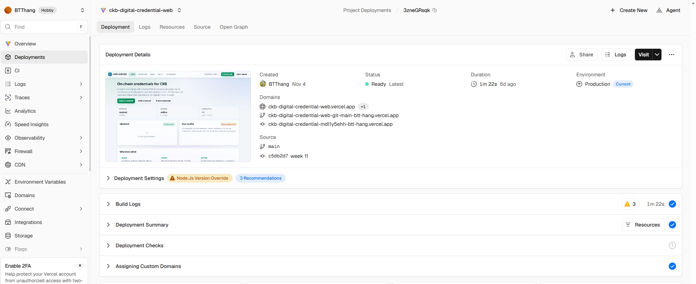
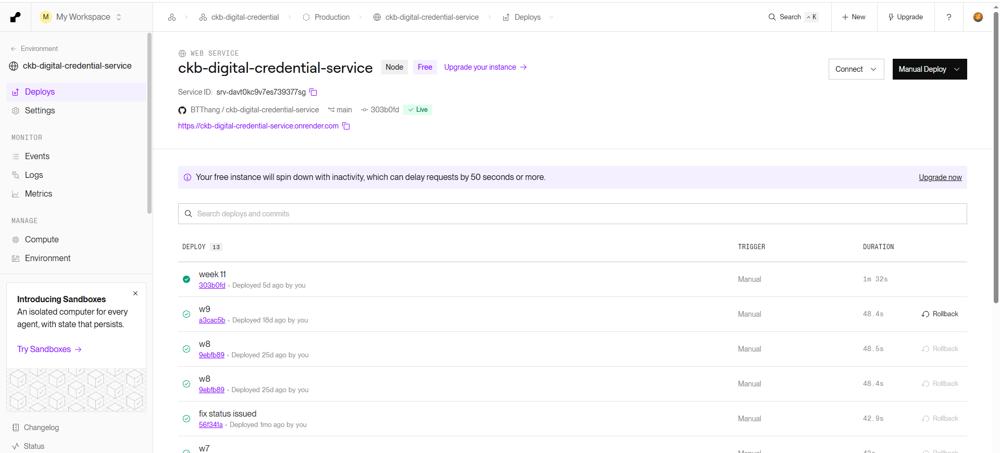

# CKB Credential Verification Infrastructure - Week 12 Report

**Report date:** 2026-11-14
**Scope:** `ckb-digital-credential-web` (Vercel), `ckb-digital-credential-service` (Render), CKB Testnet
**Report type:** Production evidence, deployment traceability audit, documentation review, and handover readiness
**Final status (updated 2026-11-14):** **PASS**

> classification and Week 12 status. Earlier `PASS WITH PENDING EVIDENCE`
> statements are preserved audit history.

---

## 1. Executive Summary

Week 12 completed the production evidence pack, deployment traceability audit,
documentation review, and handover readiness assessment. This was a
documentation and verification task; no product code, API contract,
credential-family behaviour, wallet behaviour, environment configuration, or
deployment was changed.

Both repositories are on `main`, clean, and their current `HEAD` equals both
`origin/main` and the Week 11 production baseline commits. The live production
services self-report the same commits:

- Frontend production commit: `c5db2d71e134e3a96b59f7ca7583650f199126c1`
- Backend production commit: `303b0fd87b22e095d16561a85c12ed8875cbcccc`

Read-only production checks confirmed that `/version.json`, `/api/version`, and
`/api/health` return matching build metadata, `environment: production`,
`network: testnet`, and all three credential families are available.

Four independent screenshots were initially captured against the live production
frontend: desktop verify page, desktop ownership MATCH, desktop ownership
MISMATCH, and mobile verify page layout. Production endpoint responses were
captured as JSON evidence.

The follow-up evidence set added a desktop real-wallet connection, disconnect
results for desktop and mobile, a mobile wallet menu with an explicit
`Disconnect wallet` action, a mobile connector modal, and Vercel and Render
deployment screenshots. The final Week 12.4 review covers 17 evidence files.
E4 (real wallet connected) and E8/E9 (provider deployments) are PASS with
documented caveats. E5 (desktop disconnect flow) and E7 (mobile wallet menu and
disconnect flow) are both PASS with note. The Week 12 status is therefore
**PASS**. Section 17 records the final resolution; sections 13-16 preserve the
earlier audit history.

A final read-only production check on 2026-11-10T04:42:52Z confirmed that the
frontend `/` and `/verify` pages return HTTP 200, both build identities still
report the Week 11 baseline commits, the backend health endpoint reports CKB
Testnet reachable with an advancing tip, and all three credential families are
available.

The Week 11 owner-confirmed manual desktop/mobile PASS is preserved as
owner-confirmed evidence and is clearly distinguished from independently
captured Week 12 screenshots.

---

## 2. Week 12 Objectives

| # | Objective | Result |
|---:|---|---|
| 1 | Repository and production baseline audit | PASS |
| 2 | Production evidence collection | PASS (17 files reviewed; E5 and E7 disconnect flows complete with separate-session notes) |
| 3 | Deployment traceability | PASS with note (live build metadata and provider screenshots verified; provider IDs/timestamps not visible) |
| 4 | Documentation review and Week 12 report | PASS |
| 5 | Evidence folder structure and README | PASS |
| 6 | Final handover audit and package | PASS with documented limitations |

Week 12 did not introduce new product features or change verification logic.

---

## 3. Repository Baseline Audit

Audit performed on 2026-11-10. Both repositories were fetched before comparison.

| Item | Frontend (`ckb-digital-credential-web`) | Backend (`ckb-digital-credential-service`) |
|---|---|---|
| Remote | `https://github.com/BTThang/ckb-digital-credential-web.git` | `https://github.com/BTThang/ckb-digital-credential-service.git` |
| Current branch | `main` | `main` |
| Current HEAD | `c5db2d71e134e3a96b59f7ca7583650f199126c1` | `303b0fd87b22e095d16561a85c12ed8875cbcccc` |
| `origin/main` | `c5db2d71e134e3a96b59f7ca7583650f199126c1` | `303b0fd87b22e095d16561a85c12ed8875cbcccc` |
| HEAD equals `origin/main` | Yes | Yes |
| Working tree | Clean (no uncommitted changes) | Clean (no uncommitted changes) |
| HEAD commit date | 2026-11-04T21:28:07+07:00 | 2026-11-04T21:26:53+07:00 |
| HEAD commit subject | `week 11` | `week 11` |
| Week 11 baseline commit | `c5db2d71e134e3a96b59f7ca7583650f199126c1` | `303b0fd87b22e095d16561a85c12ed8875cbcccc` |
| Week 11 baseline is ancestor of HEAD | Yes (equal) | Yes (equal) |
| Commit drift since Week 11 | None | None |

**Result: PASS.** There is no repository drift from the Week 11 baseline. The
current repository commit is identical to the Week 11 production commit for both
services. No commits were created, pushed, or deployed during Week 12.

---

## 4. Production Deployment Traceability

### 4.1 Frontend (Vercel)

| Item | Value | Status |
|---|---|---|
| Production URL | https://ckb-digital-credential-web.vercel.app/ | PASS |
| Verify page | https://ckb-digital-credential-web.vercel.app/verify (HTTP 200, `text/html`) | PASS |
| `/version.json` | HTTP 200, `application/json; charset=utf-8`, `Cache-Control: no-store` | PASS |
| Deployed source commit (self-reported) | `c5db2d71e134e3a96b59f7ca7583650f199126c1` | PASS |
| Commit equals repository HEAD | Yes | PASS |
| Version | `1.0.0` | PASS |
| Environment | `production` | PASS |
| Network | `testnet` | PASS |
| Build timestamp (`builtAt`) | `2026-11-04T14:29:28.483Z` | PASS |
| Deployment ID | Not visible in `vercel.png`; URL segment `3zneGRsqk` is visible | NOT VERIFIED |
| Deployment timestamp (provider event) | Not visible; screenshot shows `Created BTThang Nov 4` and `6d ago` | NOT VERIFIED |
| Deployment status (provider dashboard) | `Ready`, `Environment Production`, `Source main c5db2d7 week 11` | PASS with note |

### 4.2 Backend (Render)

| Item | Value | Status |
|---|---|---|
| Production API base | https://ckb-digital-credential-service.onrender.com/api | PASS |
| `/api/version` | HTTP 200, `application/json; charset=utf-8`, `Cache-Control: no-store` | PASS |
| Deployed source commit (self-reported) | `303b0fd87b22e095d16561a85c12ed8875cbcccc` | PASS |
| Commit equals repository HEAD | Yes | PASS |
| Version | `1.0.0` | PASS |
| Environment | `production` | PASS |
| Network | `testnet` | PASS |
| Build timestamp (`builtAt`) | `2026-11-04T14:29:32.607Z` | PASS |
| `/api/health` | HTTP 200, `status: ok`, `chain.reachable: true`, `chain.network: testnet` | PASS |
| `/api/health` `build.commit` equals `/api/version` commit | Yes | PASS |
| `/api/verify/families` | HTTP 200, 3 families: `spore`, `vellum-claim`, `ckb-pop` | PASS |
| Deployment ID | Service ID `srv-davtOkcgv7es739377sg` visible; deployment event ID not visible | PARTIAL |
| Deployment timestamp (provider event) | Not visible; screenshot shows `Deployed 5d ago by you` | NOT VERIFIED |
| Deployment status (provider dashboard) | `Live`, `WEB SERVICE Production`, `BTThang / main`, commit `303b0fd` | PASS with note |

Observed live chain tip in the first captured health response: block `23014219`
(CKB Testnet), at `2026-11-10T02:49:22.904Z`. A later check at
`2026-11-10T04:42:52.486Z` observed block `23015062`, confirming the tip is
advancing. The tip advances over time; each value is a point-in-time
observation, not a fixed value.

### 4.3 Traceability conclusion

The deployed artifacts **self-report** the exact Week 11 baseline commits, and
those commits equal the current repository `HEAD` and `origin/main`. This
independently confirms that the running production builds correspond to the
intended source.

Provider-side deployment IDs and deploy-event timestamps are still not fully
verified. The follow-up evidence set includes Vercel and Render dashboard
screenshots (`evidence/deployment/vercel.png` and
`evidence/deployment/render.png`) that show the projects, commits,
environments, and `Ready` / `Live` status. The screenshots do not show a
deployment event ID or an exact deploy-event timestamp. No values were inferred
or fabricated; those fields remain **NOT VERIFIED**.

A final read-only production check on 2026-11-10T04:42:52Z repeated the build
identity, health, and families checks. The results still matched the Week 11
baseline commits, so the traceability conclusion is unchanged.

---

## 5. Evidence Collection Register

Evidence files are stored under `week12/evidence/`. See `week12/README.md` for
the naming convention and classification rules.

| ID | Evidence | Classification | Status | File |
|---|---|---|---|---|
| E1 | Desktop verify page, no wallet connected | Independently captured | PASS | `evidence/desktop/2026-11-10_desktop_verify-page_unconnected.png` |
| E2 | Desktop credential verification, ownership MATCH | Independently captured (public verification) | PASS | `evidence/desktop/2026-11-10_desktop_verify-match_spore.png` |
| E3 | Desktop credential verification, ownership MISMATCH | Independently captured (public verification) | PASS | `evidence/desktop/2026-11-10_desktop_verify-mismatch_spore.png` |
| E4 | Desktop - real wallet connected | Required | PASS with caveat | `evidence/desktop/connected-JoyId.png` |
| E5 | Desktop - wallet switching and Disconnect | Required | PASS with note | `evidence/desktop/connected-JoyId.png`, `evidence/desktop/desktop_disconnect.png` |
| E6 | Mobile verify page layout | Independently captured | PASS | `evidence/mobile/2026-11-10_mobile_verify-page_unconnected.png` |
| E7 | Mobile - wallet menu and Disconnect | Required | PASS with note | `evidence/mobile/mobile_wallet-menu_disconnect.png`, `evidence/mobile/mobile_disconnected-result.png` |
| E8 | Vercel deployment details | Optional | PASS with note | `evidence/deployment/vercel.png` |
| E9 | Render deployment details | Optional | PASS with note | `evidence/deployment/render.png` |
| E10 | Live production endpoint metadata | Independently captured | PASS | `evidence/deployment/2026-11-10_frontend_version.json`, `evidence/deployment/2026-11-10_backend_version.json`, `evidence/deployment/2026-11-10_backend_health.json`, `evidence/deployment/2026-11-10_backend_families.json`, `evidence/deployment/2026-11-10_capture-log.md` |

E5/E7 were re-reviewed on 2026-11-11. E5 and E7 are now both PASS with note
after the desktop result and mobile menu/result captures were added. See section
17. The earlier PARTIAL/PENDING findings in sections 13-16 are preserved as
audit history.

### 5.1 Evidence screenshots (GitHub-rendered)

The images below use repository-relative Markdown paths. When this report is
viewed on GitHub at `week12/ckb_weekly_report_w12.md`, GitHub resolves each path
from the `week12/` directory and renders the PNG inline. Keep the filenames and
folder structure unchanged.

#### Desktop evidence

| E1 - Verify page, wallet disconnected | E2 - Spore ownership MATCH |
|---|---|
|  |  |

| E3 - Spore ownership MISMATCH | E4 - Real wallet connected |
|---|---|
|  |  |

| E5 - Disconnect action | E5 - Resulting NOT CONNECTED state |
|---|---|
|  |  |

#### Mobile evidence

| E6 - Mobile verify page | E7 - Mobile wallet menu and Disconnect action |
|---|---|
|  |  |

| E7 - Resulting disconnected state |
|---|
|  |

#### Deployment evidence

| E8 - Vercel deployment | E9 - Render deployment |
|---|---|
|  |  |

> E5 and E7 each combine screenshots from separate sessions. They prove the
> Disconnect action and the resulting disconnected state, but are not continuous
> click-to-result recordings. E5 does not claim a completed switch to a second
> account. E4 contains a public wallet address; redact it in any public-facing
> copy if disclosure is not necessary, while preserving the original evidence.

### 5.2 Capture details

| Field | Value |
|---|---|
| Capture date | 2026-11-10 |
| Endpoint capture time (UTC) | 2026-11-10T02:49:20Z |
| Frontend under test | `https://ckb-digital-credential-web.vercel.app/verify` |
| Backend under test | `https://ckb-digital-credential-service.onrender.com/api` |
| Browser | Playwright Chromium (headless) |
| Desktop viewport | 1440 x 900 |
| Mobile viewport | 390 x 844 (device scale factor 2) |
| Network | CKB Testnet |

### 5.3 MATCH / MISMATCH scenario

Both scenarios used the live Spore fixture:

- Identifier: `0x59d6ca2b82015c7fd182c5247be055fa7f644a133a105dc2b8d1b9c725e00b1a`
- On-chain owner: `ckt1qrfrwcdnvssswdwpn3s9v8fp87emat306ctjwsm3nmlkjg8qyza2cqgqq80ke04nnu6txrs2cln39hkn2y23kr64u5lr62qg`
- MATCH expected owner: the on-chain owner above.
- MISMATCH expected owner: `ckt1qzda0cr08m85hc8jlnfp3zer7xulejywt49kt2rr0vthywaa50xwsqgd605wl3fn6n6r0q8mjn58ewe77unewxqs5kpmy` (a different valid CKB Testnet address).
- Observed MATCH: `Held by the expected owner`, credential `valid`.
- Observed MISMATCH: `Held by a different address`, credential still `valid`.

This confirms the ownership comparison is independent of credential validity. It
was performed through the public verify page with a manually entered expected
owner; no wallet was connected for E2/E3.

### 5.4 What is not claimed

- E2/E3 are **not** real JoyID wallet sessions.
- No screenshot was fabricated, and no pending item is presented as completed.
- No private keys, seed phrases, tokens, passwords, or personal information were
  captured. Addresses visible in evidence are public on-chain identifiers.

### 5.5 Follow-up real-wallet and provider evidence

The initial follow-up audit reviewed the real-wallet and provider evidence. Its E5/E7 findings are superseded by the final evidence review in section 17:

| ID | Observation | Classification |
|---|---|---|
| E4 | Desktop header shows a connected wallet and a real address ending `63c7ct`. The address is not either mock harness address. The UI label is generic (`Connected via Wallet`), so the provider is inferred from the known issuer address rather than read from the screen. | PASS with caveat |
| E5 | Initial review: disconnect action/result were not yet both evidenced. Final review: action and `NOT CONNECTED` result are proven in separate sessions; no second-account switch is claimed. | PASS with note (final) |
| E7 | Initial review: mobile menu/action/result were not yet evidenced. Final review: menu, `Disconnect wallet`, and disconnected result are proven in separate sessions. | PASS with note (final) |
| E8 | Vercel dashboard shows project `ckb-digital-credential-web`, `Environment Production`, `Source main c5db2d7 week 11`, and `Status Ready`. Deployment ID and exact timestamp are not visible. | PASS with note |
| E9 | Render dashboard shows project `ckb-digital-credential-service`, `WEB SERVICE Production`, service ID `srv-davtOkcgv7es739377sg`, `BTThang / main`, commit `303b0fd`, and `Live`. Deployment event ID and exact timestamp are not visible. | PASS with note |

E4's connected address is the known JoyID issuer address, not the on-chain owner
of the Spore fixture used in E2/E3. The screenshot therefore proves a real
connected wallet session; it does not prove ownership of the specific Spore
fixture.

> This table preserves the initial follow-up assessment as audit history. Section 17 records the final classification.

The E4 screenshot exposes a full wallet address. It is a public on-chain
identifier, not a secret, but it is not required to prove the scenario. Redact
it in any public copy; never alter the original evidence file.

---

## 6. Desktop and Mobile Manual Testing Status

### 6.1 Week 11 owner-confirmed result (preserved)

The project owner confirmed in Week 11 that manual testing passed on both desktop
and mobile, including real-wallet connection, verification interaction,
ownership MATCH/MISMATCH, wallet switching, and disconnect. This is recorded as
**owner-confirmed** evidence.

Source: Week 11 report, section 12 -
https://github.com/BTThang/ckbuilder/blob/main/week11/ckb_weekly_report_w11.md

| Area | Week 11 result | Classification |
|---|---|---|
| Real wallet connection on desktop | PASS | Owner-confirmed |
| Wallet and credential verification interaction | PASS | Owner-confirmed |
| Ownership MATCH / MISMATCH interaction | PASS | Owner-confirmed |
| Wallet switching and Disconnect on desktop | PASS | Owner-confirmed |
| Desktop verification experience | PASS | Owner-confirmed |
| Mobile verification experience | PASS | Owner-confirmed |
| Mobile wallet menu / Disconnect | PASS | Owner-confirmed |

Exact device models, OS/browser versions, viewport sizes, and timestamps were not
supplied in Week 11 and are not asserted.

### 6.2 Week 12 independently captured result

| Area | Week 12 result | Classification |
|---|---|---|
| Desktop verify page renders | PASS | Independently captured |
| Desktop ownership MATCH UI | PASS | Independently captured (public verification) |
| Desktop ownership MISMATCH UI | PASS | Independently captured (public verification) |
| Mobile verify page layout | PASS | Independently captured |
| Real wallet connection | PASS with caveat | Independently captured (real session; provider label generic) |
| Wallet switching / Disconnect screenshots | PARTIAL | Unconnected state and connector modal captured; no explicit Disconnect action or second account |
| Mobile wallet menu / Disconnect screenshot | PENDING | Connector modal captured; no wallet menu or Disconnect action |
| Vercel deployment details | PASS with note | Project/commit/environment/status visible; ID/timestamp not visible |
| Render deployment details | PASS with note | Project/service ID/commit/environment/status visible; event ID/timestamp not visible |

> **Superseded later on 2026-11-11:** this table records the Week 12 result
> before the final disconnect captures. See section 17 for the final E5/E7
> classification.

---

## 7. Outstanding Evidence and Limitations

1. **Provider deployment event metadata.** Vercel and Render screenshots show
   the correct projects, source commits, production environments, and `Ready` /
   `Live` statuses. Provider deployment event IDs and exact event timestamps
   remain NOT VERIFIED; no values are inferred.
2. **Optional wallet-switch evidence.** E5 proves the desktop Disconnect action
   and resulting disconnected state. A completed switch to a second account is
   not shown and is not required to pass the disconnect flow.
3. **Separate-session evidence.** E5 and E7 combine action/menu and result
   screenshots from separate sessions. They prove the required UI states, but
   are not continuous recordings of a single click-to-result sequence.
4. **E4 public address.** The original screenshot contains a public on-chain
   wallet address. Keep the original evidence unchanged and redact a copy if it
   is shared publicly and the full address is unnecessary.
5. **Live fixtures are point-in-time.** The Spore, Vellum Claim, and CKB-PoP
   fixtures are live Testnet cells observed on 2026-11-10. A later transfer,
   melt, or state change could alter their current owner/outpoint/state.
6. **Operational limitations.** Render cold starts, ephemeral SQLite and its
   recovery path, Testnet-only validation, RPC availability/resilience, issuer
   trust/reputation being out of scope, and the absence of an uptime SLA or
   horizontal scaling remain documented in the handover package.
7. **No product changes in Week 12.** No production verification logic, API
   contract, family behaviour, wallet behaviour, environment variable, commit,
   or deployment was changed during this evidence/documentation phase.

These are evidence-traceability and operational limitations, not product
verification failures or release-gate failures.

---

## 8. Documentation Changes

Week 12 added documentation and evidence only. No existing report or evidence
was deleted or overwritten.

| File | Change |
|---|---|
| `week12/ckb_weekly_report_w12.md` | New Week 12 report (this document) |
| `week12/README.md` | New evidence-folder guide and classification rules |
| `week12/evidence/desktop/2026-11-10_desktop_verify-page_unconnected.png` | New independent screenshot |
| `week12/evidence/desktop/2026-11-10_desktop_verify-match_spore.png` | New independent screenshot |
| `week12/evidence/desktop/2026-11-10_desktop_verify-mismatch_spore.png` | New independent screenshot |
| `week12/evidence/mobile/2026-11-10_mobile_verify-page_unconnected.png` | New independent screenshot |
| `week12/evidence/deployment/2026-11-10_frontend_version.json` | Captured live response |
| `week12/evidence/deployment/2026-11-10_backend_version.json` | Captured live response |
| `week12/evidence/deployment/2026-11-10_backend_health.json` | Captured live response |
| `week12/evidence/deployment/2026-11-10_backend_families.json` | Captured live response |
| `week12/evidence/deployment/2026-11-10_capture-log.md` | Capture log with HTTP status and headers |
| `week12/evidence/desktop/connected-JoyId.png` | Follow-up real-wallet connection screenshot |
| `week12/evidence/desktop/disconnect-wallet.png` | Follow-up unconnected/connector-modal screenshot |
| `week12/evidence/mobile/disconnect-wallet.png` | Follow-up mobile connector-modal screenshot |
| `week12/evidence/deployment/vercel.png` | Vercel dashboard screenshot |
| `week12/evidence/deployment/render.png` | Render dashboard screenshot |
| `project-final-handover/` | Final handover package: 10 documents, evidence copies, production capture, checksums |

No changes were made to the frontend or backend repositories.

---

## 9. Risks and Recommendations

| # | Risk / gap | Impact | Recommendation |
|---:|---|---|---|
| 1 | Provider deployment event IDs and exact timestamps are not visible | Provider-side event traceability is incomplete even though live build metadata and dashboard status are verified | Export the exact Vercel/Render deployment event IDs and timestamps if required by the receiving team |
| 2 | E5/E7 screenshots come from separate sessions | The evidence proves the required action and resulting state, but not a continuous recording | Retain the separate-session note; capture a continuous recording only if the reviewer explicitly requires it |
| 3 | Optional second-account switch is not captured | E5 proves Disconnect, not a completed switch to another account | Capture a second-account switch only if that scenario is part of the acceptance criteria |
| 4 | Live fixtures can move | E2/E3 and Week 11 acceptance are point-in-time | Re-capture or note the observation time if fixtures change before handover |
| 5 | E4 screenshot contains a public wallet address | Public sharing may expose an address unnecessarily | Redact a separate public copy; preserve the original evidence and its checksum |
| 6 | Operational constraints remain | Cold starts, ephemeral storage, RPC resilience, and availability expectations affect operations | Apply the optional hardening actions documented in the handover package when operational requirements justify them |

None of these items changes the Week 11 PASS verdict or the final Week 12
PASS. They are documented traceability, evidence-format, and operational
considerations.

---

## 10. Final Week 12 Status

| Area | Status |
|---|---|
| Repository baseline audit | PASS |
| Repository drift since Week 11 | PASS (none) |
| Production build/version metadata | PASS |
| Production health and credential families | PASS |
| Deployment traceability | PASS with note (provider event IDs/exact timestamps not visible) |
| Desktop evidence | PASS (E1-E5; E5 PASS with note) |
| Mobile evidence | PASS (E6-E7; E7 PASS with note) |
| Real-wallet evidence | PASS with caveat (E4); E5/E7 PASS with separate-session notes |
| Week 11 owner-confirmed manual testing | PASS (owner-confirmed, preserved) |
| Documentation and evidence structure | PASS |
| Code / API / deployment changes | None (as required) |

**Final Week 12 status: PASS**

Week 12 completed the repository baseline audit, live production verification,
deployment traceability review, evidence collection, documentation review, and
final handover preparation. E5 and E7 now both have evidence for the wallet
menu/action and resulting disconnected state. Each pair of captures comes from
separate sessions, which is explicitly documented. E5 does not claim a completed
switch to a second account.

Provider deployment event IDs and exact event timestamps remain NOT VERIFIED.
This does not invalidate the live build identity checks or the PASS status; it
remains a documented traceability limitation.

### Final handover

**READY WITH DOCUMENTED LIMITATIONS**

The handover package is ready for review. Remaining notes concern provider
deployment metadata, separate-session evidence, optional second-account switch
coverage, the E4 public-address redaction for public sharing, and documented
operational limitations. These are not outstanding E5/E7 disconnect evidence
gaps.

---

## 11. Final Evidence Integrity Audit

Audit performed: 2026-11-10T03:06:14Z. This audit re-read this report,
`week12/README.md`, and every file under `week12/evidence/`. It did not modify
any evidence file and did not change production code or configuration.

### 11.1 Evidence file integrity summary

| Check | Result |
|---|---|
| Evidence files listed in the report exist | PASS - all 14 files exist |
| Screenshots are valid PNG images | PASS - 9/9 have a valid PNG signature and readable dimensions |
| JSON evidence files are valid JSON | PASS - 4/4 parse successfully |
| Evidence filenames, descriptions, dates, and classifications match the register | PASS |
| Incomplete evidence is not marked as completed | PASS - E5 remains PARTIAL; E7 remains PENDING |
| MATCH/MISMATCH are labelled as public verification, not real JoyID sessions | PASS - stated in section 5.2, 5.3, and `week12/README.md` |
| Week 11 owner-confirmed PASS is distinguished from Week 12 independent evidence | PASS - sections 6.1 and 6.2 |
| Week 11 and Week 12 report links and production URLs are correct | PASS - all checked URLs returned HTTP 200 |
| No secrets, private keys, seed phrases, passwords, or access tokens in evidence | PASS |
| No frontend/backend code or production configuration changed during Week 12 | PASS |

### 11.2 Evidence inventory (SHA-256)

| Evidence file | Type | SHA-256 |
|---|---|---|
| `evidence/desktop/2026-11-10_desktop_verify-page_unconnected.png` | PNG 1440x900 | `c80abe21e38515eb5ea010623687fe1ee22570ffcbc5a4acbd4e09c52acba2bd` |
| `evidence/desktop/2026-11-10_desktop_verify-match_spore.png` | PNG 1440x2558 | `3aefefa87891ad503b42315d840325ee5408fba74ad1873e0f5d49b38b6d274d` |
| `evidence/desktop/2026-11-10_desktop_verify-mismatch_spore.png` | PNG 1440x2558 | `d7b5eefe19b6e33fde6bc32a0b93662c706e0a22d57f63e960fd9d01dff68738` |
| `evidence/mobile/2026-11-10_mobile_verify-page_unconnected.png` | PNG 780x2312 | `5ff89f99f27529ee3c60097716d6840c44193e9c79ebf9f658b85197a45472dd` |
| `evidence/deployment/2026-11-10_frontend_version.json` | JSON | `d86ce8c4a3e1c2bd4199c2123b7eec7c2e408a5022dd9c53f9892ada35ecbeb6` |
| `evidence/deployment/2026-11-10_backend_version.json` | JSON | `ecb360af8faae8aea5a1807cb3afc055c614f9fcf048ded5425192b87d1c429e` |
| `evidence/deployment/2026-11-10_backend_health.json` | JSON | `4cc4da7c0f542100e4b725a89caf85b6f0cb66cae59f5320cc8680a6d45de16b` |
| `evidence/deployment/2026-11-10_backend_families.json` | JSON | `9cc91147b8e9c7d9c18a1d4acc78c449abfa1a2d90bffa163c0cc5c550ca8f62` |
| `evidence/deployment/2026-11-10_capture-log.md` | Markdown | `cedec13d9e4043223bb35510c85328b25d370091f091d2343f0f4d0ad97b2ee5` |
| `evidence/desktop/connected-JoyId.png` | PNG | `186e60852803f432d9c3ff6ded31873df2c9c5eb14f325bb03a24f0c50a15a1a` |
| `evidence/desktop/disconnect-wallet.png` | PNG | `5c300f4fba880338b71b329d2556ac21c33b5c7c8a6f78d73906a30b703d80f0` |
| `evidence/mobile/disconnect-wallet.png` | PNG | `1e1eda35109fdf98ecdb9b22a335ad794674eb6b053c7bb094168fce1a70e149` |
| `evidence/deployment/vercel.png` | PNG | `7b0fb9aa2830eaefe9eb2f4e46fbd411b5c6083b8e959b4d83dff03be030d100` |
| `evidence/deployment/render.png` | PNG | `9aef1372ee0caac547fe7638c8b367fb2a28f8cbf33624a86ac919d3946e05b4` |

The register in section 5 was normalized so that all E10 paths are explicit
relative paths under `evidence/deployment/`; no file was renamed or rewritten.

### 11.3 Missing or invalid files

None. No evidence file listed in the report is missing, empty, or invalid. E5
has a file but remains PARTIAL because the requested switching/disconnect action
is not visible. E7 has a file but remains PENDING because the requested mobile
wallet menu/disconnect action is not visible. No incomplete item is counted as a
completed PASS.

### 11.4 Documentation consistency results

- The initial evidence filenames use the capture date `2026-11-10`; the
  follow-up files keep their original names and are documented as exceptions.
- Screenshot descriptions in section 5 and `week12/README.md` match the observed
  scenarios: unconnected verify page, Spore MATCH, Spore MISMATCH, mobile verify
  page, connected wallet, and connector/disconnect states.
- E2/E3 are consistently classified as independent **public verification**
  captures and explicitly not real JoyID wallet sessions.
- Week 11 owner-confirmed results (section 6.1) are consistently separated from
  Week 12 independent captures (section 6.2).
- E4 is consistently classified PASS with caveat; E5 PARTIAL; E7 PENDING;
  E8/E9 PASS with note. The report and README use the same classifications.
- The final status remains `PASS WITH PENDING EVIDENCE`; E5 and E7 are still
  incomplete, so the evidence does not support changing it.

### 11.5 Link and URL check

| URL | HTTP status |
|---|---|
| https://ckb-digital-credential-web.vercel.app/ | 200 |
| https://ckb-digital-credential-web.vercel.app/verify | 200 |
| https://ckb-digital-credential-web.vercel.app/version.json | 200 |
| https://ckb-digital-credential-service.onrender.com/api/version | 200 |
| https://ckb-digital-credential-service.onrender.com/api/health | 200 |
| https://ckb-digital-credential-service.onrender.com/api/verify/families | 200 |
| https://github.com/BTThang/ckbuilder/blob/main/week11/ckb_weekly_report_w11.md | 200 |

The live endpoints still self-report the Week 11 baseline commits:
`c5db2d71e134e3a96b59f7ca7583650f199126c1` (frontend) and
`303b0fd87b22e095d16561a85c12ed8875cbcccc` (backend). The final handover audit
repeated these checks on 2026-11-10T04:42:52Z with the same result; it also
confirmed that `/` and `/verify` return HTTP 200.

### 11.6 Secret scan results

No secrets were found. The only matches for words such as "private key",
"password", or "token" are the negative statements in this report, the README,
and the capture log that explicitly say no such values are included. The 64-hex
values in the evidence text are public Spore identifiers or transaction hashes,
for example
`0x59d6ca2b82015c7fd182c5247be055fa7f644a133a105dc2b8d1b9c725e00b1a`.
Commit SHAs and transaction hashes present are public chain/build identifiers.
The E4 screenshot contains a public wallet address; it is not a secret, but it
is flagged for redaction in any public copy. The captured health response
contains the public Testnet RPC URL `wss://testnet.ckb.dev/ws`, which is public
infrastructure information, not a secret. No `.env` values, API keys, bearer
tokens, cookies, seed phrases, or private keys appear in any Week 12 file.

### 11.7 Code and configuration check

- Frontend: `main`, clean, HEAD `c5db2d71e134e3a96b59f7ca7583650f199126c1`,
  equal to `origin/main` and the Week 11 baseline.
- Backend: `main`, clean, HEAD `303b0fd87b22e095d16561a85c12ed8875cbcccc`,
  equal to `origin/main` and the Week 11 baseline.
- No tracked or untracked changes exist in either repository.
- No commit, push, deployment, environment-variable change, or production
  configuration change was made during Week 12.

### 11.8 Files changed by this audit

- `week12/ckb_weekly_report_w12.md` - normalized E10 evidence paths, added
  section 11, and recorded the final handover audit in section 12.
- `week12/README.md` - updated the evidence classification and pending tables.
- `project-final-handover/` - new handover package with 10 documents, evidence
  copies, production captures, and checksums.

No evidence file was overwritten or modified. No frontend or backend source file
was changed.

### 11.9 Audit conclusion

All listed evidence is present and valid, documentation is consistent,
incomplete items remain incomplete, the Week 11 owner-confirmed PASS is
correctly separated from Week 12 independent captures, and no secret or code
change was found.

**Final Week 12 status: PASS WITH PENDING EVIDENCE** (unchanged).

---

## 12. Final Handover Audit (Post-Week-12 Closure)

Audit performed: 2026-11-10T04:42:52Z. This section records the final handover
audit required by `week12.2.txt`. It is additive: the historical Week 12
findings in sections 1-11 are preserved.

### 12.1 Scope and constraints

- Reviewed the 14 evidence files under `week12/evidence/`.
- Reviewed the Week 11 and Week 12 reports, the Week 12 README, and the existing
  `docs/` set.
- Ran read-only production checks. No transaction, deployment, configuration
  change, commit, or push was performed.
- No product code, API contract, family behaviour, wallet behaviour, or
  environment variable was changed.
- Evidence originals were not modified. The handover package contains copies.

### 12.2 Baseline integrity

| Check | Result |
|---|---|
| Frontend `main` clean, HEAD = `origin/main` | PASS - `c5db2d7...` |
| Backend `main` clean, HEAD = `origin/main` | PASS - `303b0fd...` |
| HEAD equals Week 11 baseline | PASS - both |
| Remote access via `git ls-remote` | PASS - all three repositories reachable |
| Commit drift since Week 11 | None |

### 12.3 Final production check

| Check | Result |
|---|---|
| Frontend `/` | 200 `text/html` |
| Frontend `/verify` | 200 `text/html` |
| Frontend `/version.json` | 200; `c5db2d7...`; `production`; `testnet` |
| Backend `/api/version` | 200; `303b0fd...`; `production`; `testnet` |
| Backend `/api/health` | 200; `status: ok`; CKB reachable; tip `23015062` |
| Backend `/api/verify/families` | 200; `spore`, `vellum-claim`, `ckb-pop` |

Full details: `project-final-handover/evidence/production/production-verification-2026-11-10.md`.

### 12.4 Final evidence classification

| Evidence | Final classification | Reason |
|---|---|---|
| E1 | PASS | Desktop verify page without a wallet |
| E2 | PASS | Spore ownership MATCH, public verification |
| E3 | PASS | Spore ownership MISMATCH, public verification |
| E4 | PASS with caveat | Real connected-wallet session; provider label generic; address is the known JoyID issuer, not the Spore fixture owner |
| E5 | PARTIAL | Unconnected state and connector modal visible; no second account, switch action, or explicit Disconnect item |
| E6 | PASS | Mobile verify page layout |
| E7 | PENDING | Mobile connector modal visible; no wallet menu or Disconnect action |
| E8 | PASS with note | Vercel project/commit/environment/status visible; deployment ID and exact timestamp not visible |
| E9 | PASS with note | Render project/service ID/commit/environment/status visible; deployment event ID and exact timestamp not visible |
| E10 | PASS | Build identity, health, families, and capture log |

The Week 12 status remains `PASS WITH PENDING EVIDENCE` because E5 and E7 are
still incomplete.

### 12.5 Handover package

Created `project-final-handover/` containing:

- `README.md`
- `01-project-overview.md`
- `02-system-architecture.md`
- `03-api-reference.md`
- `04-local-development-guide.md`
- `05-deployment-guide.md`
- `06-testing-and-acceptance.md`
- `07-operations-and-troubleshooting.md`
- `08-security-and-limitations.md`
- `09-final-project-report.md`
- `10-handover-checklist.md`
- `evidence/week12/` - 14 byte-for-byte evidence copies
- `evidence/production/` - final production JSON captures and verification note
- `evidence/SHA256SUMS.txt` - checksums for the handover evidence copies

### 12.6 Documentation coverage

The handover package covers:

- Project scope, roles, supported families, and final status.
- Architecture, trust model, verification core, lifecycle, and data model.
- Public and authenticated API contracts, errors, and consumer rules.
- Local development, environment variables, and the localhost cookie trap.
- Vercel/Render deployment, environment variables, smoke tests, and rollback.
- Automated gates, production acceptance, evidence register, and boundaries.
- Operations, health/readiness semantics, troubleshooting, and maintenance.
- Security model, threat model, limitations, and residual risks.
- Final report and a sign-off checklist.

Week 1-7 reports are not available in the workspace. Early milestones are not
reconstructed, because doing so would fabricate history.

### 12.7 Final handover status

**READY WITH DOCUMENTED LIMITATIONS**

The system is deployed, the release gates passed, and the production build
matches the repository baseline. The handover is ready with documented limitations. Remaining notes are:

- Provider deployment event IDs and exact timestamps are not verified.
- E5/E7 evidence uses separate sessions; a completed second-account switch is
  optional and not shown.
- Operational hardening options include addressing Render cold starts,
  ephemeral SQLite, monitoring, and fallback RPC.
- Create a redacted public copy of E4 if the screenshot is shared publicly.

These are documentation, traceability, and operational considerations, not
release-gate failures.

---

## 13. Final Gap Closure Review (week12.3)

Review performed: 2026-11-10. This section records the review required by
`week12.3.txt`. It is additive: sections 1-12 and all historical results are
preserved unchanged. Full detail is in
`week12/week12.3_final_gap_closure.md`.

### 13.1 E5 and E7 re-inspection

> **Correction (2026-11-11):** Section 14 re-inspected E5 as a group and found
> that `connected-JoyId.png` visibly contains a `Disconnect wallet` action. The
> E5 classification remains PARTIAL; only the step-level detail below is
> corrected. Historical text is preserved for audit traceability.

The task stated that the owner added the requested E5/E7 screenshots. This
review found no new image files. The E5 and E7 files are byte-for-byte identical
to the files already audited in section 12, with SHA-256 values matching the
section 11.2 inventory exactly
(`desktop/disconnect-wallet.png` = `5c300f4f...d80f0`;
`mobile/disconnect-wallet.png` = `1e1eda35...e149`). No evidence was fabricated
or altered.

The screenshots were re-inspected (valid PNG and OCR text extraction). The
findings are unchanged:

| Evidence | Requested steps | Visibly proven | Final classification |
|---|---|---|---|
| E5 desktop | wallet switching; disconnect action; resulting disconnected state | Switching UI shown (connected address `ckt1qrfrwc...63c7ct`, `Other wallets`, connector modal with `JoyID Passkey` and `UTXO Global Wallet`); no second account/switch result, no `Disconnect` control, no disconnected state. No `Disconnect` text appears. | **PARTIAL** |
| E7 mobile | wallet menu; disconnect action; resulting disconnected state | Connector modal only (`Connect Wallet`, `JoyID Passkey`, `UTXO Global Wallet`); no wallet menu, no `Disconnect` control, no disconnected state. | **Not proven / PENDING** |

Neither E5 nor E7 shows the claimed disconnect result. They are not reclassified
as PASS. The Week 11 owner-confirmed manual PASS remains the only record for
those interactions.

### 13.2 E8 and E9 re-review

| Evidence | Correct project | Production env | Status | Source commit | Deployment ID | Exact timestamp |
|---|---|---|---|---|---|---|
| E8 Vercel (`vercel.png`) | Yes - `ckb-digital-credential-web` | Yes - `Production` | Yes - `Ready`, `Latest` | Yes - `main`, `c5db2d7`, `week 11` | Partial - deployment URL segment `md11y5ehh` and token `3zneGRsqk` visible; no labelled Deployment ID | No exact value (`Created BTThang Nov 4`, `6d ago`) |
| E9 Render (`render.png`) | Yes - `ckb-digital-credential-service` | Yes - `WEB SERVICE`, `Production` | Yes - `Live` | Yes - `BTThang / main`, `303b0fd`, `week 11` | Partial - service ID `srv-davtOkcgv7es739377sg` visible; no deploy-event ID | No exact value (`Deployed 5d ago by you`) |

Both remain **PASS with note**. Missing fields are recorded as NOT VERIFIED and
are not inferred. The Render screenshot also shows the free-instance cold-start
notice, which supports the documented operational limitation.

### 13.3 Technical documentation audit

All twelve required developer tasks are covered by the handover documentation:
clone both repositories; install dependencies; configure the local environment;
run frontend and backend; run automated tests; understand the API contracts;
understand Spore, Vellum Claim, and CKB-PoP verification; deploy the frontend to
Vercel; deploy the backend to Render; check production health; troubleshoot
common failures; and understand security boundaries and wallet signing. The only
non-blocking documentation gap is that Render deployment is dashboard-configured
(no `render.yaml`), which is an optional improvement.

### 13.4 Operational limitations

Render cold starts, ephemeral SQLite and its recovery path, Testnet-only
validation, RPC availability/resilience, issuer trust/reputation being out of
scope, and the absence of an uptime SLA or horizontal scaling are all documented
in `05`, `07`, `08`, `09`, and `10` of the handover package. Current production
limitations and optional future improvements are kept separate.

### 13.5 Verdict

**Week 12 status: `PASS WITH PENDING EVIDENCE`** (unchanged, because E5 and E7
remain incomplete).

**Final handover: `READY WITH DOCUMENTED LIMITATIONS`** (unchanged). No product,
release-gate, or documentation-readiness failure was found. The remaining open
items are evidence completeness (E5/E7), provider deployment event IDs/exact
timestamps, and optional operational hardening.

---

## 14. Week 12.3 Re-inspection Correction Addendum

Re-inspection performed: 2026-11-11. This section is additive. Sections 1-13
and every historical result, test count, classification, and production commit
SHA above are preserved unchanged. It corrects one step-level detail in the E5
assessment after re-inspecting the desktop evidence as a group.

### 14.1 Evidence integrity recheck

The task stated that the owner added the requested E5/E7 screenshots. A fresh
re-read of `week12/evidence/` found no file with a modification time later than
2026-11-10, and all SHA-256 values still match section 11.2 exactly. The evidence
set is still 14 files. No evidence file was modified, renamed, or added by this
re-inspection.

The relevant desktop files are:

- `evidence/desktop/connected-JoyId.png` - `186e60852803f432d9c3ff6ded31873df2c9c5eb14f325bb03a24f0c50a15a1a` (1405x557)
- `evidence/desktop/disconnect-wallet.png` - `5c300f4fba880338b71b329d2556ac21c33b5c7c8a6f78d73906a30b703d80f0` (1890x607)
- `evidence/mobile/disconnect-wallet.png` - `1e1eda35109fdf98ecdb9b22a335ad794674eb6b053c7bb094168fce1a70e149` (332x718)

### 14.2 Corrected E5 step-level finding

Section 13.1 assessed `disconnect-wallet.png` alone. The task requires assessing
multiple screenshots as a group when they cover one scenario. Re-reading
`connected-JoyId.png` shows the open account menu contains an explicit
`Disconnect wallet` item. The corrected finding is:

| Requested step | Visibly proven? | Evidence |
|---|---|---|
| Wallet switching | Partial | `disconnect-wallet.png` shows the connected address chip, `Other wallets`, and the `Connect Wallet` modal (`JoyID Passkey`, `UTXO Global Wallet`). No second account, connector selection, or switched address is shown. |
| Disconnect action | **Yes** | `connected-JoyId.png` shows `Signed in`, the full address, `Copy address`, `Connected via Wallet`, `Profile`, `My Credentials`, `Issued Credentials`, `Logout`, and `Disconnect wallet`. |
| Resulting disconnected state | No | Both desktop files still show the connected address chip; no post-disconnect state is shown. |

**Corrected E5 classification: PARTIAL (unchanged) with corrected detail.** The
disconnect action is now correctly recorded as visibly proven. The scenario is
still incomplete because the resulting disconnected state and a completed switch
are not shown. E5 must not be classified PASS.

### 14.3 E7, E8, E9 reconfirmation

- **E7 mobile (`mobile/disconnect-wallet.png`):** still `PENDING`. The header
  shows the connected address chip `ckt1qrfrwc...63c7ct` and `Other wallets`,
  and the overlay `Connect Wallet` modal lists `JoyID Passkey` and `UTXO Global
  Wallet`. No wallet menu, no `Disconnect` control, and no disconnected state
  are visible.
- **E8 Vercel (`vercel.png`):** still `PASS with note`. Visible: project
  `ckb-digital-credential-web`, `Environment Production`, `Status Ready`,
  `Latest`, source `main` / `c5db2d7` / `week 11`, domain
  `ckb-digital-credential-web.vercel.app`, deployment URL segment `md11y5ehh`,
  and relative timestamp `6d ago`. No labelled deployment event ID or exact
  deploy-event timestamp.
- **E9 Render (`render.png`):** still `PASS with note`. Visible: project
  `ckb-digital-credential-service`, `WEB SERVICE`, `Production`, service ID
  `srv-davtOkcgv7es739377sg`, `BTThang / main`, commit `303b0fd`, status `Live`,
  and the free-plan cold-start notice. No deployment event ID or exact
  deploy-event timestamp.

### 14.4 Documentation and limitations reconfirmation

The twelve required new-developer tasks remain covered by the handover package
(`01`-`10`), both repository READMEs, both `.env.example` files, `vercel.json`,
and `docs/`. The only non-blocking deployment-documentation gap remains that
Render is dashboard-configured (no `render.yaml`). Operational limitations
(Render cold starts, ephemeral SQLite, Testnet-only validation, RPC
availability/resilience, issuer trust out of scope, no uptime SLA or horizontal
scaling) remain explicitly documented and separated from optional future work.

### 14.5 Status after correction

**Week 12 status: `PASS WITH PENDING EVIDENCE`** (unchanged, because the E5
disconnected result and all of E7 remain incomplete).

**Final handover: `READY WITH DOCUMENTED LIMITATIONS`** (unchanged). No product,
release-gate, or documentation-readiness failure was found. The only correction
is that the desktop `Disconnect wallet` action is now recorded as visibly
proven.

---

## 15. Week 12.4 Final Evidence Update

Review performed: 2026-11-11. Task source: `week12.4.txt`. This section is
additive. Sections 1-14 and every historical result, test count, classification,
commit SHA, and hash above are preserved unchanged.

### 15.1 Additional E5/E7 files: renamed, not new

The only changes under `week12/evidence/desktop/` and
`week12/evidence/mobile/` are two renames:

| Previous file | Current file | Bytes | Last write | SHA-256 |
|---|---|---:|---|---|
| `desktop/disconnect-wallet.png` | `desktop/desktop_disconnect-wallet.png` | 120478 | 2026-11-10 10:40:22 | `5c300f4fba880338b71b329d2556ac21c33b5c7c8a6f78d73906a30b703d80f0` |
| `mobile/disconnect-wallet.png` | `mobile/mobile_disconnect-wallet.png` | 44820 | 2026-11-10 10:41:03 | `1e1eda35109fdf98ecdb9b22a335ad794674eb6b053c7bb094168fce1a70e149` |

No newly added screenshot file exists: the folders still contain five desktop
images and two mobile images. Each renamed file has the same byte length,
modification time, and SHA-256 as the previous file, so this is a filename change
only, not new visual evidence. The handover copies under
`project-final-handover/evidence/week12/` still use the previous names and the
same hashes; they remain valid byte-for-byte copies and were not modified.

### 15.2 Visual inspection reconfirmation

- **Desktop `desktop_disconnect-wallet.png` (1890x607).** Shows the connected
  address chip `ckt1qrfrwc...63c7ct`, `Other wallets`, and the `Connect Wallet`
  modal (`JoyID Passkey`, `UTXO Global Wallet`). No `Disconnect` text and no
  post-disconnect state.
- **Desktop `connected-JoyId.png` (1405x557).** Supplies the E5 disconnect-action
  proof: the open account menu shows `Signed in`, the full address, `Copy
  address`, `Connected via Wallet`, `Profile`, `My Credentials`, `Issued
  Credentials`, `Logout`, and an explicit `Disconnect wallet` item. The header
  still shows the connected chip, so the result state is not shown.
- **Mobile `mobile_disconnect-wallet.png` (332x718).** Shows the connected chip,
  `Other wallets`, and the `Connect Wallet` modal only. No account menu, no
  `Disconnect` control, and no disconnected state.

### 15.3 E5 and E7 status

| ID | Classification | Reason |
|---|---|---|
| E5 | **PARTIAL** | The disconnect action is visibly proven in `connected-JoyId.png`; the resulting disconnected state and a completed wallet switch are not shown. |
| E7 | **PENDING** | No mobile account menu, disconnect action, or disconnected state is visible. |

E5 and E7 are not reclassified and must not be presented as completed.

### 15.4 Integrity and consistency

The two renamed files hash to the same values recorded in section 11.2:

- `desktop_disconnect-wallet.png` = `5c300f4f...d80f0`
- `mobile_disconnect-wallet.png` = `1e1eda35...e149`

No evidence content, product code, API contract, environment, commit, or
deployment was changed. `week12/README.md`, the Week 12.3 gap closure report,
and the final handover evidence register were updated to use the renamed
originals while noting that the handover copies keep the previous names.

Full report: `week12/week12.4_final_evidence_update.md`.

### 15.5 Status after Week 12.4 review

**Week 12 status: `PASS WITH PENDING EVIDENCE`** (unchanged, because the E5
disconnected result and all of E7 remain incomplete).

**Final handover: `READY WITH DOCUMENTED LIMITATIONS`** (unchanged). No new
screenshot content was found, so no new PASS claim is made.

> **Superseded later on 2026-11-11:** the owner then added two genuinely new
> files, `desktop_disconnect.png` and `mobile_disconnect.png`. See section 16 for
> the next stage and section 17 for the final evidence resolution.

---

## 16. Week 12.4 Final Evidence Resolution

Review performed: 2026-11-11. This section is additive. Sections 1-15 and every
historical result, test count, commit SHA, and prior classification remain
preserved. Section 16 supersedes section 15 for the final E5/E7 classification.

### 16.1 Two new files

The first Week 12.4 check found only renames. The owner then added two new files:

| File | Bytes | Last write | Dimensions | SHA-256 |
|---|---:|---|---:|---|
| `evidence/desktop/desktop_disconnect.png` | 157686 | 2026-11-11 10:38:42 | 1419x750 | `323fbff9bfa64b835e2d9206437da78c5da335942a382d74da6b6f877d34d089` |
| `evidence/mobile/mobile_disconnect.png` | 106168 | 2026-11-11 10:40:13 | 390x754 | `5d06bfd5b61d4c945a87d94e65facfa8beb863623dd870dbc943ff1602ef1c43` |

Neither file matches a previous hash. The Week 12 evidence set is now 16 files:
six desktop images, three mobile images, and seven deployment files.

### 16.2 Desktop - E5 is now PASS with note

`desktop_disconnect.png` shows `Connect JoyID`, `Other wallets`, no connected
address chip, and a `NOT CONNECTED` label. Read with `connected-JoyId.png`,
which shows the explicit `Disconnect wallet` action in the open account menu, the
group proves both required steps:

| Required step | Proven | Evidence |
|---|---|---|
| Disconnect action | Yes | `connected-JoyId.png` |
| Resulting disconnected state | Yes | `desktop_disconnect.png` (`NOT CONNECTED`) |
| Completed second-account switch | No | Optional evidence; not required for the disconnect flow |

**E5: PASS with note.** A completed wallet switch is not shown and must not be
claimed. The connected-menu capture shows TIP 23014536 and the result capture
shows TIP 23025452, so they are separate sessions; the group proves the action
and the disconnected state, not a single continuous click-to-result recording.

### 16.3 Mobile - E7 remains PENDING

`mobile_disconnect.png` shows `Connect JoyID` and `Other wallets` with no
connected address chip, consistent with a disconnected or unconnected session.
It does not show the mobile account menu or a `Disconnect` control, and it does
not tie the state to a disconnect action. It is partial supporting evidence
only.

**E7: PENDING.** The required account-menu, disconnect-action, and resulting
state sequence is not fully proven.

### 16.4 Handover package and integrity

The two new files were copied byte-for-byte into:

- `project-final-handover/evidence/week12/desktop/desktop_disconnect.png`
- `project-final-handover/evidence/week12/mobile/mobile_disconnect.png`

`project-final-handover/evidence/SHA256SUMS.txt` was regenerated and now covers
16 Week 12 evidence copies plus the five production-capture files. The previous
connector-modal copies are unchanged.

### 16.5 Final status

- **E5:** PASS with note (disconnect action and disconnected result proven;
  completed switch not shown).
- **E7:** PENDING (disconnected-looking mobile state only; no menu or disconnect
  action).
- **E8/E9:** PASS with note (unchanged).
- **Week 12 status:** `PASS WITH PENDING EVIDENCE` (E7 is the only remaining
  incomplete screenshot item).
- **Final handover:** `READY WITH DOCUMENTED LIMITATIONS` (unchanged).

> **Superseded later on 2026-11-11:** the owner added the mobile wallet-menu
> screenshot with the `Disconnect wallet` action and renamed the mobile result
> file. See section 17 for the final resolution.

Full report: `week12/week12.4_final_evidence_update.md`.

---

## 17. Week 12.4 Final Mobile Evidence Resolution

Review performed: 2026-11-11. This section is additive. Sections 1-16 and every
historical result, test count, commit SHA, and prior classification remain
preserved. Section 17 supersedes section 16 for the final E7 classification.

### 17.1 Final mobile files

The owner added the mobile wallet-menu screenshot and renamed the previous
mobile result file:

| File | Bytes | Last write | Dimensions | SHA-256 | Status |
|---|---:|---|---:|---|---|
| `evidence/mobile/mobile_wallet-menu_disconnect.png` | 128538 | 2026-11-11 10:58:42 | 393x817 | `93db738cad916c263b27331742f4d18b3deec2b681be635dcab7587becf2b383` | New |
| `evidence/mobile/mobile_disconnected-result.png` | 106168 | 2026-11-11 10:40:13 | 390x754 | `5d06bfd5b61d4c945a87d94e65facfa8beb863623dd870dbc943ff1602ef1c43` | Renamed from `mobile_disconnect.png`; content unchanged |

The mobile evidence set is now four files. The Week 12 evidence set is 17 files:
six desktop, four mobile, seven deployment.

### 17.2 Mobile visual proof

- `mobile_wallet-menu_disconnect.png` shows `TESTNET TIP 23025617`, the connected
  address chip `ckt1qrfrwc...jr62qg`, `Connected wallet`, the full address,
  `Copy address`, `Connected via JoyID`, and an explicit `Disconnect wallet`
  item.
- `mobile_disconnected-result.png` shows `Connect JoyID`, `Other wallets`, no
  connected address chip, and `TESTNET TIP 23025468`.

The menu, the disconnect action, and the resulting disconnected state are all
visibly proven. The two captures are from separate sessions (different tip
heights), so the group proves the action and the result, not a continuous
recording.

### 17.3 E7 classification

| Required step | Proven | Evidence |
|---|---|---|
| Mobile account/wallet menu | Yes | `mobile_wallet-menu_disconnect.png` |
| Disconnect action | Yes | `mobile_wallet-menu_disconnect.png` (`Disconnect wallet`) |
| Resulting disconnected state | Yes | `mobile_disconnected-result.png` (`Connect JoyID`, no chip) |

**E7: PASS with note.** The two captures are separate sessions, not one
continuous recording.

### 17.4 Handover package and final status

The two final mobile files were copied/renamed byte-for-byte into:

- `project-final-handover/evidence/week12/mobile/mobile_wallet-menu_disconnect.png`
- `project-final-handover/evidence/week12/mobile/mobile_disconnected-result.png`

`project-final-handover/evidence/SHA256SUMS.txt` was regenerated and now covers
17 Week 12 evidence copies plus the five production-capture files.

- **E5:** PASS with note (separate-session action + result; optional switch not
  shown).
- **E7:** PASS with note (separate-session menu + action + result).
- **E8/E9:** PASS with note (unchanged).
- **Week 12 status:** `PASS`.
- **Final handover:** `READY WITH DOCUMENTED LIMITATIONS` (provider deployment
  IDs/timestamps, optional completed-switch capture, separate-session evidence
  notes, and operational limitations remain documented).
